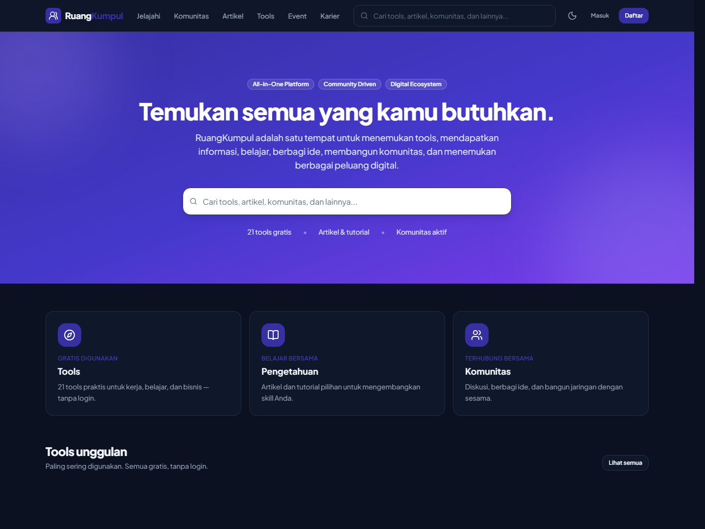
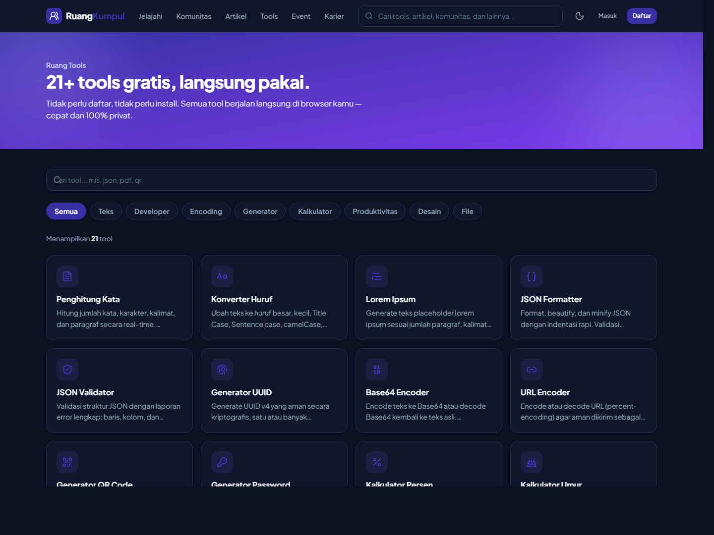
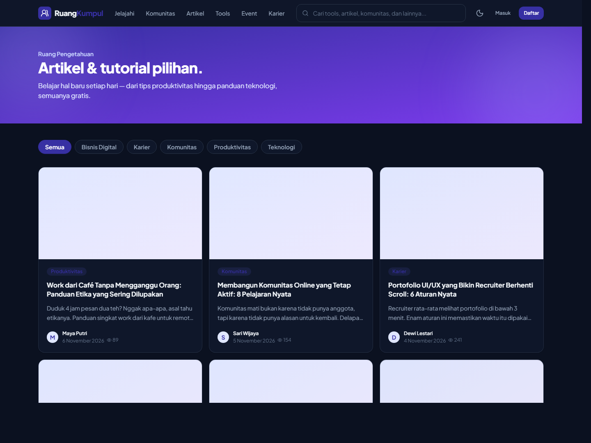
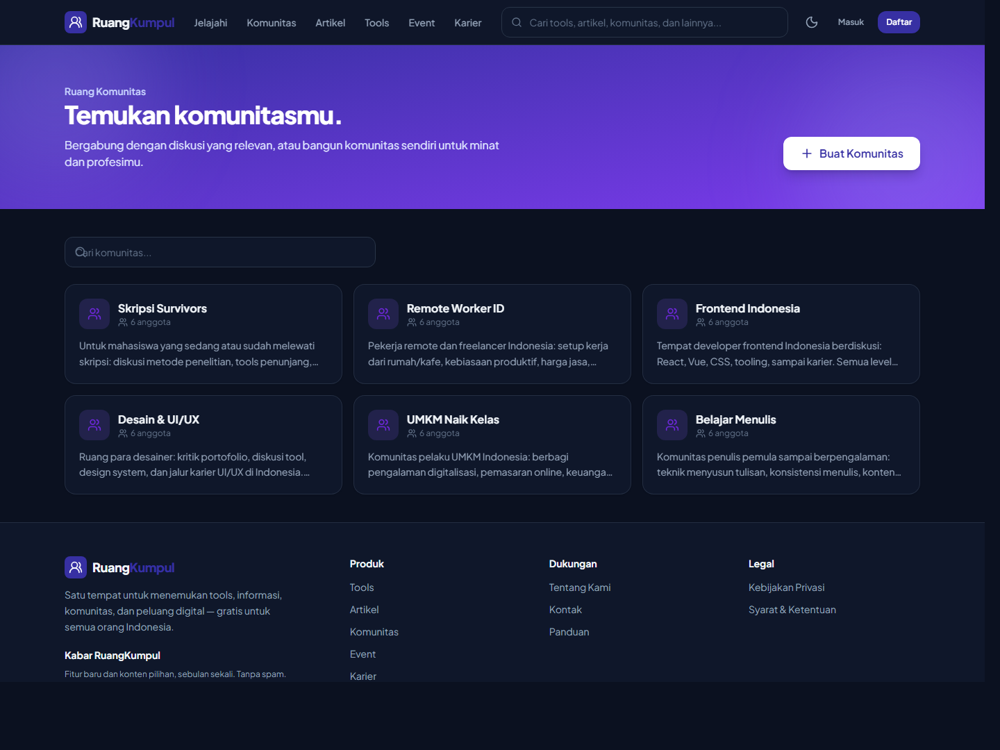
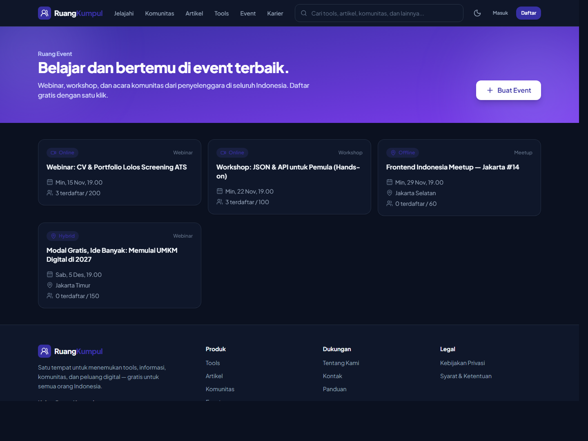
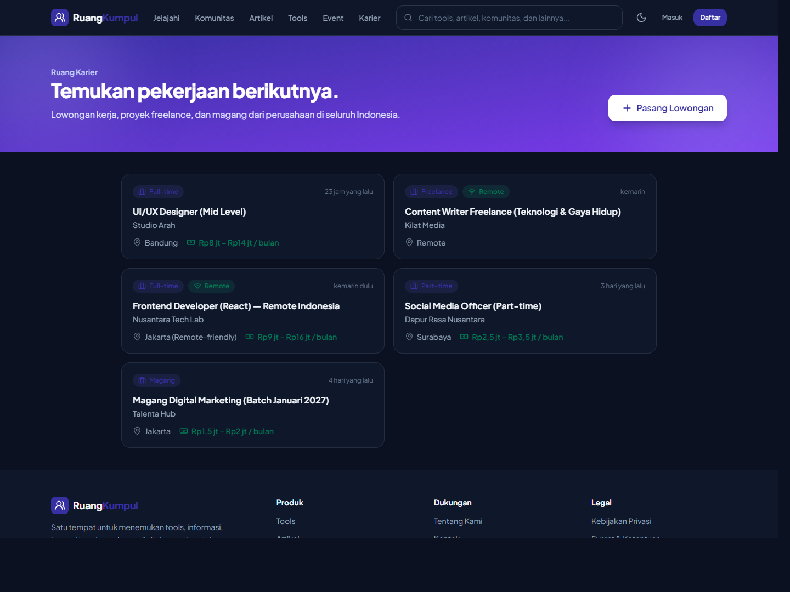

<div align="center">

# RuangKumpul

**One Platform. Endless Possibilities.**

All-in-One Digital Super App untuk Indonesia: tools gratis, ruang pengetahuan, komunitas, event, karier, dan produktivitas — dalam satu akun.

[](https://nextjs.org)
[](https://react.dev)
[](https://www.typescriptlang.org)
[](https://tailwindcss.com)
[](https://supabase.com)
[](https://vercel.com)

🌐 **Live:** [ruangkumpul.my.id](https://ruangkumpul.my.id)



</div>

## Tangkapan Layar

<table>
  <tr>
    <td width="50%" align="center"><br><b>Ruang Tools</b> — 21+ tools gratis, tanpa login</td>
    <td width="50%" align="center"><br><b>Ruang Pengetahuan</b> — artikel &amp; tutorial pilihan</td>
  </tr>
  <tr>
    <td width="50%" align="center"><br><b>Ruang Komunitas</b> — diskusi &amp; jaringan</td>
    <td width="50%" align="center"><br><b>Ruang Event</b> — webinar, workshop, meetup</td>
  </tr>
  <tr>
    <td colspan="2" align="center"><br><b>Ruang Karier</b> — lowongan kerja, freelance, &amp; magang</td>
  </tr>
</table>

## Fitur

- **Ruang Tools** — 21 tool gratis tanpa login, landing page SEO + JSON-LD per tool, favorit tool, bookmark, dan usage analytics.
- **Ruang Pengetahuan** — artikel dengan kategori, tag, komentar, view counter, bookmark, dan **editor artikel untuk kontributor** (markdown sederhana → blok JSONB, alur draft/review/terbit).
- **Ruang Komunitas** — buat/gabung komunitas, diskusi, komentar (edit/hapus sendiri), suka, bookmark, laporan moderasi, **kelola anggota** (setujui/tolak/promote moderator), komunitas privat dengan persetujuan.
- **Ruang Event** — buat event (online/offline/hybrid), pendaftaran peserta dengan kuota, JSON-LD Event.
- **Ruang Karier** — pasang & temukan lowongan (full-time/part-time/kontrak/freelance/magang), remote flag, rentang gaji, JSON-LD JobPosting.
- **Ruang Produktivitas** — catatan pribadi (pin/edit) dan papan tugas 3 kolom.
- **Notifikasi otomatis** — trigger DB: komentar, suka, komentar artikel, selamat datang; bell di header dengan badge; preferensi per jenis.
- **Akun** — email/password + Google OAuth, profil publik, upload avatar, bookmark universal, ganti email, hapus akun (UU PDP).
- **Admin** — statistik platform, kelola role, status tools & artikel, antrean moderasi, audit log.
- **Pencarian global** — DB-backed (ILIKE + index trigram) lintas artikel, komunitas, dan diskusi, dengan autocomplete.
- **Lainnya** — dark mode, pagination, rate limiting berbasis database, newsletter, beranda terpersonalisasi.

## Stack Teknologi

| Layer | Teknologi |
|---|---|
| Frontend | Next.js 16 (App Router, Cache Components), React 19, Tailwind CSS v4, TypeScript |
| Backend | Supabase (PostgreSQL + Auth + Storage + RLS) |
| Icons & util | lucide-react, zod, @supabase/ssr |
| Tools browser | qrcode, pdf-lib (100% client-side) |
| Testing | Vitest (unit) + skrip smoke test RLS |
| Hosting | Vercel |

## Mulai Cepat (Lokal)

1. **Install dependensi**

   ```bash
   npm install
   ```

2. **Siapkan environment** — salin `.env.example` menjadi `.env.local`, lalu isi `NEXT_PUBLIC_SUPABASE_URL`, `NEXT_PUBLIC_SUPABASE_ANON_KEY`, dan opsional `SUPABASE_SERVICE_ROLE_KEY` dari Supabase Dashboard → Project Settings → API keys.

3. **Jalankan migrasi database** — buka Supabase Dashboard → SQL Editor, jalankan isi file **secara berurutan**:

   - `supabase/migrations/0001_initial_schema.sql`
   - `supabase/migrations/0002_article_comments.sql`
   - `supabase/migrations/0003_platform_features.sql`
   - `supabase/migrations/0004_new_modules.sql`
   - `supabase/migrations/0005_seed_tools.sql`

   Lalu (opsional, disarankan) jalankan `docs/rls-tests.sql` untuk smoke test RLS.

4. **Isi konten awal (opsional)** — seeder mengisi persona penulis, komunitas, artikel, diskusi, event, dan lowongan agar situs tidak kosong saat pertama dibuka:

   ```bash
   npm run seed
   ```

   Idempoten — aman dijalankan berulang. Semua persona memakai email `@ruangkumpul.my.id` dan bisa dihapus dari dashboard bila tidak diinginkan.

5. **Aktifkan Google OAuth** (opsional) — Supabase Dashboard → Authentication → Providers → Google. Redirect URI: `https://<project-ref>.supabase.co/auth/v1/callback`.

6. **Jalankan**

   ```bash
   npm run dev
   ```

## Perintah Penting

```bash
npm run dev      # server development (Turbopack)
npm run build    # build produksi
npm run start    # jalankan hasil build
npm run lint     # eslint
npm test         # unit tests (vitest)
npm run seed     # isi konten awal (persona, artikel, komunitas, event, loker)
npx tsc --noEmit # cek tipe TypeScript
```

## Struktur Proyek

```
src/
├── app/                  # Route groups: (public), (auth), (dashboard), admin, api
├── components/           # ui/ (primitives) + layout/ + shared/ (bookmark-button)
├── modules/              # Feature-based: tools, knowledge, community, events,
│   │                     # careers, productivity, newsletter, users, admin...
│   └── tools/
│       ├── tools-registry/   # Sumber kebenaran data 21 tools
│       └── components/tools/ # 21 komponen tool (client, code-split)
├── lib/                  # supabase/ (client, server, admin, proxy) + rate-limit + utils
├── types/                # Tipe Database Supabase
└── config/               # Konfigurasi situs
supabase/migrations/      # SQL migration 0001–0005 (schema + RLS + trigger + seed)
docs/rls-tests.sql        # Smoke test RLS (jalankan di SQL Editor)
docs/screenshots/         # Screenshot tampilan aplikasi (dipakai README ini)
tests/unit/               # Unit tests (vitest)
```

## Keamanan

- **RLS aktif di semua tabel** — kebijakan per tabel (lihat `docs/blueprint-ruangkumpul.md` §6.4 + migrasi 0003/0004).
- **Service role key** opsional — semua operasi admin berjalan lewat RLS; service role hanya dipakai untuk hapus akun. Tanpa key, hapus akun beralih ke mode anonimisasi + arahan ke admin.
- Role pengguna via tabel `user_roles` dengan helper `is_admin()`/`is_moderator()` (SECURITY DEFINER, bebas recursive RLS).
- **Rate limiting berbasis database** (`check_rate_limit`) pada aksi tulis: komentar, post, komunitas, artikel, event, lowongan, bookmark, laporan.
- Laporan konten tervalidasi target-nya ada + dedup per pengguna (unique index).
- Tidak ada IP mentah yang disimpan; tool usage log bersifat anonim.

## Deploy ke Vercel

1. Push repositori ini ke GitHub.
2. Import di Vercel → set Environment Variables (sama seperti `.env.local`, plus `NEXT_PUBLIC_SITE_URL=https://ruangkumpul.my.id`).
3. Tambahkan domain `ruangkumpul.my.id` (dan `www`) di Vercel → Settings → Domains.
4. Arahkan DNS di registrar sesuai instruksi Vercel.

Panduan lengkap: `docs/deployment.md`.
